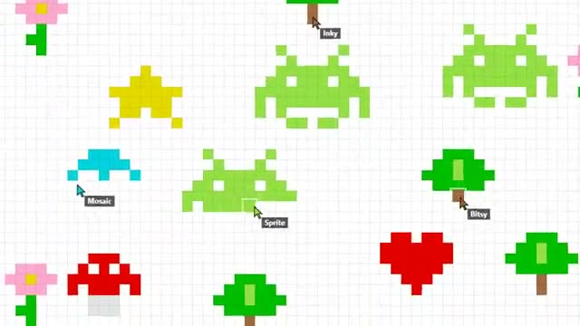

# Pixel Wall

One shared canvas, one pixel at a time. A multiplayer starter game from [Multiplayer Agent](https://multiplayeragent.com): 2D, drop-in, 2–30 players, with bots that paint while you wait for company.

## How it plays

Place one pixel every couple of seconds. Work with others to draw something, or paint over them. Bots paint little pictures while you wait for company.

**Controls:** Click or tap a square to paint, drag to move, scroll or pinch to zoom.

## Make it yours in the Game Builder

Open the [Game Builder](https://multiplayeragent.com), choose **Start from a starter game** and pick Pixel Wall. It opens as version 1 in your studio, ready to play and publish. Then ask for changes, for example:

- Make the canvas bigger, with zoom
- Add a timelapse replay
- Clear the wall every Sunday

## Run it yourself

1. Get a free publishable key (`pk_…`) at [multiplayeragent.com](https://multiplayeragent.com).
2. In `index.html`, put it in place of `pk_REPLACE_ME` in the `MP_CONNECT` block.
3. Open `index.html` in a browser. No build step and no server needed.

Without a key it still runs, offline with bots, and remembers your wall in this browser.

## How it is built

- One `index.html`. The comment at the top of the script maps the code and explains the multiplayer.
- **World memory:** The wall is remembered by the players who painted it. Every player saves a copy every 10 seconds and when they leave; whoever comes back first brings it back for everyone, and a copy with more painting in it replaces a newer, emptier one.
- **Live ops:** Change the wait between pixels (`cooldownMs`), the 16-color `palette` or the `theme` banner from the live config, with no new deploy. A running live event's title shows in the banner.
- **Leaderboard:** The players who have placed the most pixels, under the trophy button.
- **Host-run rules:** The host's browser checks every pixel and the wait between them. If it leaves, the next player takes over.
- **Bots:** Bots paint hearts, trees and space invaders until enough people join.
- `?attract` runs it offline with bots only. The preview video is recorded from it.

## License

MIT.
